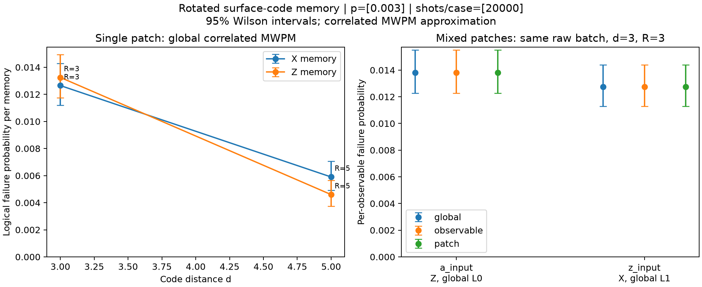

# M6-C memory demonstration results

[Verification](verification.txt) · [Full pytest result](pytest.txt) ·
[Ruff result](ruff.txt) · [Aggregate CSV](memory_results.csv) ·
[Detailed aggregate JSON](memory_results.json) · [Vector figure](memory_ler.svg)



The five cases use 20,000 shots each at circuit-level p=0.003, with seeds
20261108 through 20261112. Each experiment samples the physical circuit once.
Global, observable-local and strict patch decoders share the stored raw batch.
The left panel shows X/Z d=3/5 R=d. The right compares identical observable scopes
on concurrent independent mixed X/Z patches; it does not compare a two-output
union rate with a one-output rate. Error bars are 95% Wilson intervals.

Logical failure is predicted XOR actual reference-relative observable flip.
Raw readout parity, affine interpretation and intended eigenvalue are tested
separately. The correlated MWPM decoder is heuristic; canonical physical DEMs
retain their semantics. These estimates do not establish a decoding threshold.

Reproduce from the repository with the development extra installed:

```bash
python -m pytest --junitxml=implementation_files/e2etest/pytest.xml
python -m ruff check src tests examples
python examples/memory_offline_decoding.py --suite --shots 20000 --p 0.003 --seed 20261108 --output-dir implementation_files/e2etest
```

See verification.txt for exact versions and seed portability limits. Full local
build/example/JUnit logs remain here but are ignored; only compact aggregate
reports, final test/lint results and figures are tracked. Raw samples are not
persisted. This directory is excluded from package distributions.
