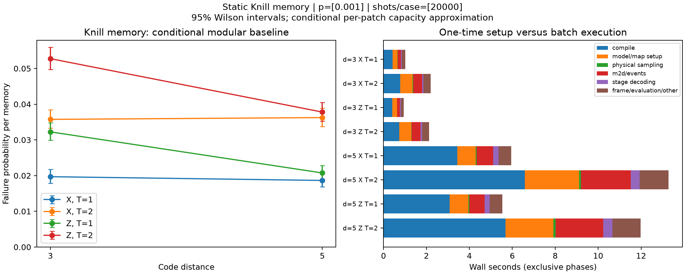

# M6-D Knill memory results

This folder is separate from the existing M6-C ordinary-memory results.

[Verification](verification.txt) · [Full pytest](pytest.txt) ·
[Wall-time and bottleneck report](wall_time_report.md) ·
[Phase CSV](knill_timing.csv) · [Aggregate JSON](knill_results.json) ·
[Vector figure](knill_ler_and_timing.svg)



Eight cases: d=3/5, X/Z, T=1/2, 20,000 shots each (160,000 total), circuit-level
p=0.001, seeds 20261108 through 20261115. Input/resource SE uses d full rounds;
one ordinary SE round follows each teleportation. All gates/noise are static;
all stage decoders reuse one raw physical batch per experiment. Error bars are
95% Wilson intervals. Timing bars show exclusive phases from an unprofiled run.

The conditional per-patch capacity Bell baseline and temporal MWPM are approximate;
these curves do not establish a threshold or optimal recovery. Exact conditional
fault actions and canonical global physical DEMs remain available to alternatives.
Final failure compares software-corrected output against the intended logical bit,
independently of decoder beliefs. No raw shot data or profiler binary is committed.

```bash
python -m pytest --durations=15 --junitxml=implementation_files/e2etest/m6d_knill/pytest.xml
python -m ruff check src tests examples
python examples/knill_memory_offline_decoding.py --suite --shots 20000 --p 0.001 --seed 20261108 --output-dir implementation_files/e2etest/m6d_knill
```

See wall_time_report.md for the full-process measurement, per-phase conventions,
machine/load caveats, profiler evidence and optimization candidates. Local full
build/example/JUnit logs stay ignored. These compact reports and figures are
explicitly tracked; all implementation_files reports are pruned from distributions.
